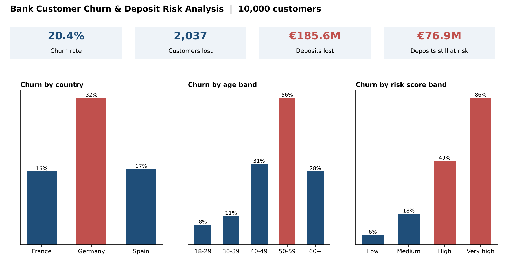

# Bank Customer Churn & Deposit Risk Analysis

**Domain:** Retail Banking (BFSI) | **Tools:** Excel, Power Query, Power BI, DAX, SQL (MySQL)

A retail bank was losing one in five of its customers. I analysed 10,000 customer records to find out who is leaving, how much money leaves with them, and which customers the retention team should call first.

---

## Business Problem

Every customer who closes an account takes their deposits with them. Deposits are a bank's cheapest source of funding, so losing them hurts twice. The retention team needed answers to:

1. What is our churn rate, and how much in deposits have we lost?
2. Which customer groups leave the most?
3. Are we losing our most valuable customers?
4. Can we spot customers likely to leave **before** they go?
5. Where should the team focus first?

## Headline Results

| Metric | Result |
|---|---|
| Churn rate | **20.4%** (2,037 of 10,000 customers) |
| Deposits lost | **€185.6M**, which is 24% of total deposits |
| Biggest problem market | **Germany**: 32% churn, 25% of customers but 53% of money lost |
| Where the money went | Customers with €100k+ balances made up **86%** of deposits lost |
| Highest-risk group | Inactive customers aged 50+: **over 80%** left |
| Retention call list | **579** existing customers holding **€76.9M**, flagged as high risk |

## Key Findings

1. **Germany is the main problem.** 32% churn vs 16-17% in France and Spain, and German customers hold the largest balances.
2. **Older, inactive customers leave the most.** Churn peaks at 56% for ages 50-59. Inactive 60+ customers churn at 86%, active ones at just 13%.
3. **Two products is the sweet spot.** 8% churn with 2 products vs 28% with 1, while 3-4 product holders churn at 83-100%.
4. **The bank is losing its most valuable customers.** €100k+ customers churn at 25% and took €159.5M out of the bank.
5. **Women churn more than men** (25% vs 16%).
6. **Credit score and tenure don't drive churn.** Churn is flat across both, so this is an engagement and product-fit problem, not a credit problem.

## Churn Risk Score

A simple points-based score built from the drivers above (Germany, age 45-64, inactive, 1 product, 3-4 products, female). It is easy to explain to branch teams and works in Excel, SQL or Power BI.

| Risk band | Customers | Actual churn |
|---|---|---|
| Low (0-2) | 4,327 | 5.8% |
| Medium (3-4) | 3,708 | 18.2% |
| High (5-6) | 1,563 | 49.1% |
| Very high (7+) | 402 | 86.1% |

## Recommendations

1. **Work the 579-customer call list, Germany first.** Saving 1 in 4 expected leavers keeps about **€10M** in deposits.
2. **Re-engage inactive customers aged 45+** with calls and loyalty offers.
3. **Cross-sell a second product** to the 3,675 single-product customers.
4. **Review customers holding 3-4 products** to find the product or service issue.
5. **Investigate the German market** through exit surveys and competitor comparison.
6. **Track churn and deposits at risk monthly** in an MIS report.

## What I Did

- **Power Query:** merged two messy Excel sheets, standardised country labels, converted currency text to numbers, removed duplicates, created age, balance and credit score bands
- **Power BI + DAX:** interactive dashboard with churn KPIs, geography, age, products and activity analysis, plus slicers
- **SQL (MySQL):** 10 queries covering KPIs, segment analysis, deposit loss, the risk score and the call list, using CASE, CTEs and window functions
- **Excel:** MIS report with KPI summary, segment tables and a ranked retention call list with a suggested action per customer

## Files

| File | What it is |
|---|---|
| `Bank_Churn_Deposit_Risk_Report.pdf` | Full project report (11 pages) |
| `Bank Customer Churn Analysis.pbix` | Power BI dashboard |
| `churn_analysis_queries.sql` | All SQL queries |
| `Churn_Risk_MIS_Report.xlsx` | MIS summary, retention call list, risk score logic |
| `charts/` | Analysis charts |
| `Bank Customer Churn Analysis.png` | Dashboard screenshot |

## Dashboard

## Dataset

10,000 retail bank customers (France, Germany, Spain): credit score, geography, gender, age, tenure, balance, products held, card holder, active member, estimated salary and churn flag.
